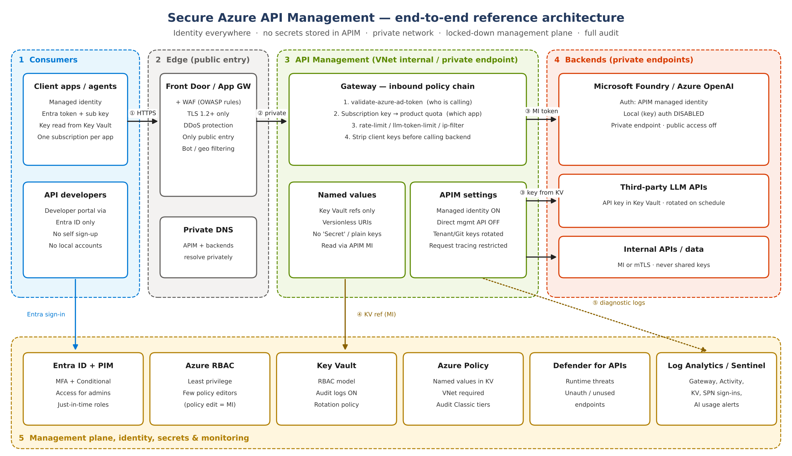

# APIM advisory toolkit (`apimtk`)

A command-line tool for customers affected by the **Azure API Management (APIM) Classic tiers security advisory of
November 2026** (Service Health tracking ID **MZK9-GH0**).

Run it against your own Azure environment. In a few minutes it:
- finds your APIM instances and tells you which ones are affected
- lists every credential stored in them that you need to rotate (it never reads their values)
- flags changes you may not have made
- builds an Excel tracker for the rotation work

It only reads from Azure. Nothing changes unless you run a `remediate` command with `--apply`.

> **Disclaimer:** community tool, provided as-is under the MIT license. It is **not** an official Microsoft tool
> and isn't supported by Microsoft. The advisory in your Azure portal (Service Health > Security advisories) is
> the authoritative source.

## Run it on your Azure environment

**You need:** Python 3.10 or later, the [Azure CLI](https://learn.microsoft.com/cli/azure/install-azure-cli), and
the **Reader** role on the subscriptions that hold your APIM instances. Azure Cloud Shell (Bash) works too: it
already has Python and the Azure CLI, and you're already signed in.

**1. Install**
```bash
git clone https://github.com/hamza-roujdami/apim-advisory-toolkit.git
cd apim-advisory-toolkit
python3 -m venv .venv && source .venv/bin/activate
pip install -e .
```

**2. Sign in and run**
```bash
az login --tenant <your-tenant-id>
apimtk run --customer Contoso
```
This scans every subscription you can read. To limit it, add `--subscription <id>` (repeatable).

**3. Open the results** in the `out/` folder:

| File | What it is |
|---|---|
| `APIM-advisory_Contoso_tracker.xlsx` | Your work tracker. Start with the **Credentials** tab |
| `Contoso_report.md` | A short summary to paste into email or Teams |
| `assess.json`, `inventory.json` | Raw results (never secret values) |

The tracker tabs:
- **Tracker:** one row per instance, with its priority, whether the advisory lists it, and its runtime check.
- **Credentials:** everything to rotate, with columns for the date you rotated it and the date you revoked the old one.
- **Findings:** every issue found, with the action to take.
- **Recent changes:** operations on each instance from the Azure Activity log. Mark the ones you don't recognise.
- **APIs & backends:** what sits behind each instance. Note the data or system each one reaches.

**Optional:** to see whether the advisory lists your instances (rather than only your subscriptions), you also need
the **Service Health Security Reader** role, Owner or Contributor ([Microsoft Learn][impacted]). Without it, the
tracker marks the whole subscription as listed when the advisory names it.

## Then work through the tracker

Follow Microsoft's order for every credential ([Tech Community][rotate]):
1. Create the replacement at the issuer (the backend, LLM provider or identity provider).
2. Update APIM.
3. Test.
4. Revoke the old credential. Updating the value in APIM alone doesn't revoke anything.

Also:
- **Investigate.** Check the sign-in and access logs of every system those credentials unlock.
  `apimtk hunt` gives you starting queries (see [Hunt](#hunt)).
- **Harden.** Move secrets to Key Vault, use managed identities instead of keys, and turn off what you don't use
  ([Tech Community][rotate], [Secure API Management][secure-apim]).

[docs/RUNBOOK.md](docs/RUNBOOK.md) has a step-by-step checklist.

## Target architecture (after hardening)

Where to aim once the rotation is done, based on Microsoft's guidance for
[securing API Management][secure-apim] and [named values in Key Vault][named-values]:



| Layer | Key controls |
|---|---|
| 1 Consumers | Managed identity, Entra token **and** subscription key, keys in Key Vault, one subscription per app; developer portal Entra-only, no sign-up |
| 2 Edge | Front Door / Application Gateway + WAF as the only public entry, TLS 1.2+, DDoS |
| 3 APIM | VNet internal / private endpoint; `validate-azure-ad-token` → subscription quota → rate/token limits; named values = Key Vault refs; managed identity on; **direct management API off**, tenant/Git keys rotated |
| 4 Backends | Private endpoints; Foundry/AOAI via APIM managed identity with key auth disabled; third-party keys only in Key Vault |
| 5 Control plane | Entra ID + PIM + Conditional Access for admins, least-privilege RBAC (policy edit = identity), Key Vault audit, Azure Policy, Defender for APIs, Log Analytics / Sentinel |

`harden/` has example Bicep, Azure Policy and an AI gateway policy for parts of this.

## The advisory in brief

Every point comes from the [sources](#sources) at the end.

- On **18 Nov 2026** Microsoft identified an issue in APIM Classic tiers that "could allow unauthorized access to
  certain management functionality if the service was not configured according to documented security best
  practices". Microsoft **closed the access path on 19 Nov 2026**. ([BleepingComputer][bc], [The Hacker News][thn])
- **Affected tiers:** Developer, Basic, Standard and Premium. **Not affected:** the Consumption tier and all v2
  tiers. ([BleepingComputer][bc])
- **What may have been exposed:** secrets stored in named values; client secrets of identity providers; client
  secrets of OpenID Connect providers; subscription keys; tokens used to call the direct management API.
  ([BleepingComputer][bc])
- The fix "does not automatically invalidate credentials that may have been accessed before the fix was deployed".
  Microsoft asks affected customers to rotate potentially exposed credentials, investigate suspicious activity and
  review their logs. ([BleepingComputer][bc])
- Norway's National Security Authority (NSM) advises everyone using APIM to **assume their secrets and named
  values are exposed and rotate all of them**. ([NSM][nsm])

## What it checks

Every credential type in Microsoft's rotation guide ([Tech Community][rotate]) becomes a row in the **Credentials** tab.

| Credential | What apimtk finds |
|---|---|
| Named values | Secrets stored in APIM, plain values that look like keys, and Key Vault references, with where each is used. Rotate Key Vault references too: anyone who could manage APIM could read them through policies or tracing ([Microsoft Learn][named-values]) |
| Subscription keys | Every active subscription, including the built-in all-access one |
| Direct management API and Git access keys | Whether each is enabled; their keys are listed for regeneration either way |
| Identity providers, OAuth 2.0 servers, OpenID Connect providers, Credential Manager | Each one's client secret |
| Backend credentials | Keys written into backend headers, query parameters or authorization; keys in API service URLs (`?code=`, `sig=`, saved masked); client certificates |
| Logger connection strings | Event Hubs loggers that use a connection string. Application Insights keys are reported as Info only: Microsoft says they "aren't security tokens or security keys" ([Microsoft Learn][ai-keys]) |
| Credentials written into policies | Keys, passwords, SAS signatures and embedded certificates in global, product, API, operation and fragment policies |
| Certificates | Certificates uploaded to APIM |

It also checks:
- **Changes you may not have made:**
  - subscriptions created and developer portal users registered recently
  - write and secret-read operations in the Azure Activity log, which keeps 90 days
- **The gateway runtime version**, against NSM's published thresholds ([NSM][nsm]). An instance below them is
  flagged **Critical**: contact Microsoft support. Microsoft says the fix is already deployed to every
  Microsoft-hosted instance ([BleepingComputer][bc]).

Useful options for `apimtk run`:

| Option | Use it to |
|---|---|
| `--subscription <id>` | Scan only these subscriptions (repeatable) |
| `--since 2026-10-01` | Flag changes since this date (default: as far back as the Activity log allows) |
| `--no-runtime-check` | Skip the runtime check, for gateways only reachable inside a virtual network |
| `--out <folder>` (before `run`) | Write the results somewhere other than `out/` |

## Fix things (optional, dry run first)

The `remediate` command makes the APIM-side changes for one instance. Without `--apply` it only prints what it would
send. With `--apply` it asks before each action, and it records every change in `out/remediation-log.json`. You need
the API Management Service Contributor role on the instance.

```bash
APIM=/subscriptions/<sub>/resourceGroups/<rg>/providers/Microsoft.ApiManagement/service/<name>

# Containment: turn off the direct management API, regenerate its keys, enable managed identity.
# The direct management API was retired in March 2025 (Microsoft Learn). Move anything that still calls it to Azure Resource Manager first.
apimtk remediate --instance $APIM --containment          # dry run
apimtk remediate --instance $APIM --containment --apply

# Subscription keys, in Microsoft's order. Coordinate with app owners.
#   1. Move each app to its secondary key, then:
apimtk remediate --instance $APIM --action regen-sub-keys --which primary --apply
#   2. Move each app to the new primary key, then:
apimtk remediate --instance $APIM --action regen-sub-keys --which secondary --apply

# A secret you've already rotated at its source and stored in Key Vault: point the named value at it.
apimtk remediate --instance $APIM --action link-keyvault \
  --named-value <name> --secret-uri https://<kv>.vault.azure.net/secrets/<name> --apply

# OAuth 2.0 / OpenID Connect / identity provider: create the new secret at the issuer, then set it here.
# You type it at a hidden prompt; the log records ***.
apimtk remediate --instance $APIM --action update-client-secret --provider oidc:<id> --apply
#   --provider oauth2:<id> | oidc:<id> | idp:<aad|aadB2C|google|...>
```

Other actions: `delete-default-products`, `disable-portal-signup`. Run `apimtk remediate --help` for the list.

The toolkit never creates or rotates secrets at their source, so LLM provider, Foundry/Azure OpenAI, Event Hubs and
app registration secrets are rotated by their owners. Keys written into policies or backends are fixed by hand: store
them in Key Vault and reference them as `{{named value}}`.

## Hunt

```bash
apimtk hunt --workspace-id <log-analytics-workspace-guid> --app-id <app-ids-whose-secrets-were-in-apim>
apimtk hunt      # no workspace: writes the queries to out/hunt/ to paste into Log Analytics or Sentinel
```
Six queries: APIM operations, new callers, new gateway sources, Key Vault reads, service principal sign-ins, and
Azure OpenAI/Foundry usage. You need the Log Analytics Reader role on the workspace.

## Safety and limitations

- **Read-only by default.** Only `remediate --apply` writes to Azure.
- **No secret values are saved.** The toolkit never calls `listValue` or `listSecrets`. Plain named values, backend
  settings and policies are checked in memory for keys written in clear text; only names, locations and verdicts
  are saved.
- **Treat the `out/` folder as sensitive:** it lists your instances, credential names and findings.
- **It can't prove whether a credential was read.** A security researcher notes that direct management API calls
  aren't recorded in the Activity log ([Anders Kristiansen][ak]). The tool looks for changes and later use.
- **Spotting keys written in clear text is a heuristic.** Review the Credentials tab.
- **The files in `harden/` are examples** and haven't been deployment-tested. Run `az bicep build` and `what-if` first.

## Optional: try it before using it

You don't need either of these to use the tool.
- **Offline sample report** (no Azure needed): `apimtk --out out/demo demo --customer Contoso`
- **Test lab:** [lab/](lab/README.md) deploys test APIM instances seeded with every scenario above into a sandbox
  subscription, runs the tool, applies the fixes and checks the results. We use it to test the toolkit; it costs a
  few dollars a day while it runs.
- **Proof it works:** [docs/lab-results/](docs/lab-results/README.md) has the sanitized tracker, report and check
  results from an end-to-end lab run on real Classic instances.

## Sources

About the advisory:
- [BleepingComputer, 23 Nov 2026][bc]: quotes the Service Health advisory MZK9-GH0 and Microsoft's statements on
  affected tiers and the fix.
- [The Hacker News, 24 Nov 2026][thn]: quotes the advisory.
- [NSM (Norwegian National Security Authority), 20 Nov 2026, updated 23 Nov][nsm]: recommended actions and the
  runtime-version check (in Norwegian).
- [Microsoft Tech Community, Rotating credentials in Azure API Management, 21 Nov 2026][rotate]: Microsoft's guide
  to finding and rotating every credential type.
- [Anders Kristiansen, 21 Nov 2026][ak]: researcher's analysis and hunting queries (community, not official).

Microsoft documentation:
- [Security advisories in Azure Service Health][sa-roles] and [Impacted resources from security advisories][impacted]
- [Secure your Azure API Management deployment][secure-apim]
- [Use named values in API Management policies (including Key Vault)][named-values]
- [Subscriptions in API Management][subs]
- [Direct management API retirement (March 2025)][direct-api]
- [Use managed identities in API Management][mi]
- [API Management v2 tiers overview][v2]
- [Application Insights connection strings][ai-keys]

[bc]: https://www.bleepingcomputer.com/news/security/microsoft-azure-flaw-exploited-to-steal-customers-api-credentials/
[thn]: https://thehackernews.com/2026/11/microsoft-fixes-azure-api-management.html
[nsm]: https://nsm.no/aktuelt/nsm-deler-tiltak-mot-sarbarhet-i-azure-api-management
[rotate]: https://techcommunity.microsoft.com/blog/integrationsonazureblog/rotating-credentials-in-azure-api-management/4575478
[ak]: https://anderskristiansen.com/post/2026/apim-legacy-access/
[sa-roles]: https://learn.microsoft.com/azure/service-health/security-advisories-elevated-access
[impacted]: https://learn.microsoft.com/azure/service-health/impacted-resources-security
[secure-apim]: https://learn.microsoft.com/azure/api-management/secure-api-management
[named-values]: https://learn.microsoft.com/azure/api-management/api-management-howto-properties
[subs]: https://learn.microsoft.com/azure/api-management/api-management-subscriptions
[direct-api]: https://learn.microsoft.com/azure/api-management/breaking-changes/direct-management-api-retirement-march-2025
[mi]: https://learn.microsoft.com/azure/api-management/api-management-howto-use-managed-service-identity
[v2]: https://learn.microsoft.com/azure/api-management/v2-service-tiers-overview
[ai-keys]: https://learn.microsoft.com/azure/azure-monitor/app/connection-strings

## For contributors
```
apimtk/      the CLI (assess, inventory, report, hunt, remediate)
kql/         hunting queries used by `apimtk hunt`
harden/      example Azure Policy, Bicep and APIM policy (not deployment-tested)
lab/         optional test environment (see lab/README.md)
docs/        runbook and architecture diagrams
tests/       offline tests against a fake tenant: pip install -e ".[dev]" && pytest
```
