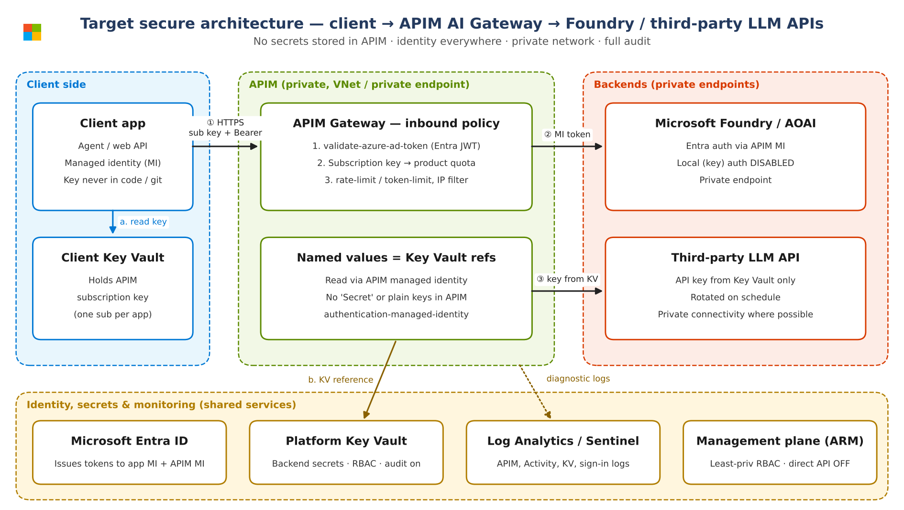

# APIM advisory toolkit (`apimtk`)

Helps any customer respond to the **November 2026 Azure API Management Classic-tiers security advisory**
(Service Health tracking ID **MZK9-GH0**): find affected instances, list the secrets they expose, hunt for
misuse, rotate safely, and harden so it can't happen again.

> Microsoft closed the access path on 19 Nov 2026. Secrets stored in APIM before then may have been read, and
> the platform fix does **not** invalidate them. Treat everything stored in a Classic APIM instance as exposed.



## What's in the box

| Phase | Command | What it does | Changes Azure? |
|---|---|---|---|
| 01 Assess | `apimtk assess` | Lists every APIM instance (Resource Graph), tags Classic vs v2, checks advisory membership per subscription | No |
| 02 Inventory | `apimtk inventory [--deep]` | Named values (plain values that look like keys, secrets in APIM, Key Vault references), where each is used, subscriptions, all-access key, default products, direct management API, portal sign-up, Credential Manager, managed identity | No |
| Report | `apimtk report` | Excel tracker (Tracker / Findings / Named values) + Markdown summary | No |
| 03 Hunt | `apimtk hunt` | KQL pack: APIM secret reads, new callers, new gateway sources, Key Vault reads, SPN sign-ins, Foundry/AOAI usage | No |
| 04 Remediate | `apimtk remediate` | Disable tenant access, regenerate tenant keys, secondary→primary subscription key swap, link named values to Key Vault, delete default products, disable sign-up, enable managed identity | **Only with `--apply`** |
| 05 Harden | `harden/` | Azure Policy definitions, Bicep for Key Vault named values + managed identity to Foundry, reference AI gateway policy XML | You deploy |

`apimtk run` = assess + inventory + report in one read-only pass.

## Quick start

```bash
pip install -e ".[identity]"        # or just: pip install requests openpyxl  (+ az login)
az login --tenant <customer-tenant>

apimtk --out out/contoso run --customer Contoso            # read-only, ~1-2 min per instance
apimtk --out out/contoso run --customer Contoso --deep     # also map {{named values}} to policies
apimtk --out out/contoso report --customer Contoso --cve CVE-XXXX-YYYY   # optional reference in title
```

Try it offline first: `apimtk --out out/demo demo --customer Contoso`

Output in `out/contoso/`:
- `assess.json`, `inventory.json`: raw results (no secret values, ever)
- `<ref>_<customer>_tracker.xlsx`: send to the customer or track the work in it
- `<customer>_report.md`: paste into email or Teams

## Test it on real Classic instances (lab)

`lab/` deploys two Developer-tier APIM instances seeded with every risk the toolkit looks for, then checks the results before and after remediation:

```bash
./lab/run-lab.sh deploy you@contoso.com && ./lab/run-lab.sh before
./lab/run-lab.sh fix && ./lab/run-lab.sh after && ./lab/run-lab.sh teardown
```
See [lab/README.md](lab/README.md).

## Remediation (dry run first)

```bash
APIM=/subscriptions/<sub>/resourceGroups/<rg>/providers/Microsoft.ApiManagement/service/<name>

# Containment: tenant access off + regenerate its keys + managed identity on
apimtk remediate --instance $APIM --containment                 # prints what would be sent
apimtk remediate --instance $APIM --containment --apply         # asks before each action

# Subscription keys - coordinate with app owners first!
apimtk remediate --instance $APIM --action regen-sub-keys --which secondary --apply
#   ...apps switch to the new secondary key...
apimtk remediate --instance $APIM --action regen-sub-keys --which primary --apply

# Backend secret: rotate at the source (LLM provider / Foundry / Entra) -> store in Key Vault -> link
apimtk remediate --instance $APIM --action link-keyvault \
  --named-value embedding-api-key --secret-uri https://<kv>.vault.azure.net/secrets/embedding-api-key --apply
```

Every write is recorded in `out/remediation-log.json`.

## Permissions

| Task | Minimum role |
|---|---|
| assess / inventory / report | Reader on the subscriptions + `API Management Service Reader` |
| Advisory impacted resources | Owner/Contributor, or a role with `Microsoft.ResourceHealth/events/fetchEventDetails/action` |
| hunt | Log Analytics Reader on the workspace |
| remediate | `API Management Service Contributor` on the instance |
| harden (Bicep) | Contributor + `User Access Administrator` (for role assignments) |

## Safety model
- **Read-only by default.** Only `remediate --apply` writes, and it asks for confirmation on each action unless you pass `--yes`.
- **No secret values.** The toolkit never calls `listValue` or `listSecrets`. Plain named values are checked in memory to spot clear-text keys, and only the name and verdict are kept.
- **The toolkit doesn't rotate backend keys.** Third-party LLM provider, Foundry/AOAI and app registration secrets are rotated by their owners at the source. The toolkit then links the new Key Vault secret.

## Layout
```
apimtk/            CLI + modules (arm, assess, inventory, hunt, remediate, report)
kql/               hunting queries ({lookback}, {fix_date}, {app_ids} placeholders)
harden/policy/     Azure Policy definitions (audit first, then deny)
harden/bicep/      secure-ai-gateway.bicep: Key Vault named values, MI to Foundry, tenant access off
harden/apim-policies/ ai-gateway-api-policy.xml: validate-azure-ad-token + MI + token limit
lab/               seed.bicep + run-lab.sh + verify.py: end-to-end test on 2 real Classic instances
docs/              RUNBOOK.md, email templates, target architecture
tests/             offline tests against a fake tenant (pytest)
```

## Status / limitations
- The REST calls use APIM API version `2022-08-01` and Resource Health `2022-10-01`.
- The Bicep and Policy files haven't been deployment-tested. Run `az bicep build` and `what-if` before using them, and check the Policy aliases in your tenant.
- The advisory's access path was on Microsoft's platform, so the hunt queries can't prove whether a read happened. They look for **misuse** of the secrets afterwards.
- The plain-value key detection is a heuristic. Review the Named values tab.
